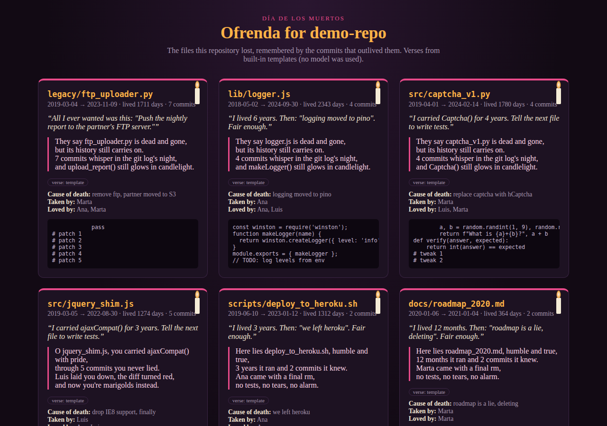
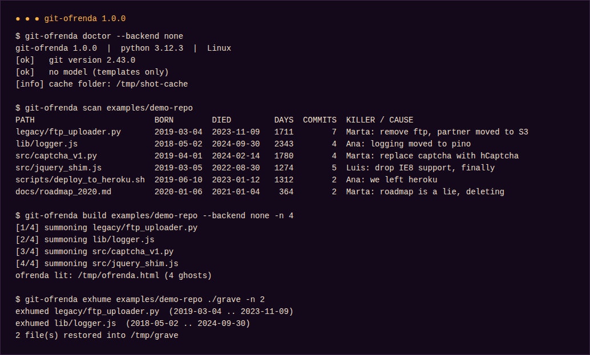
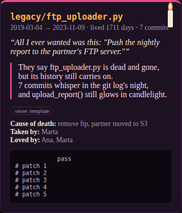
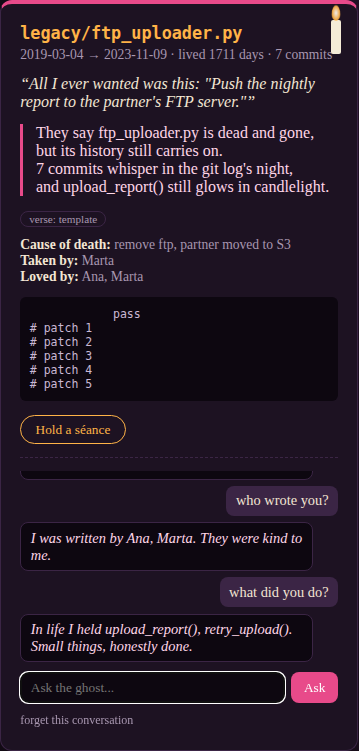
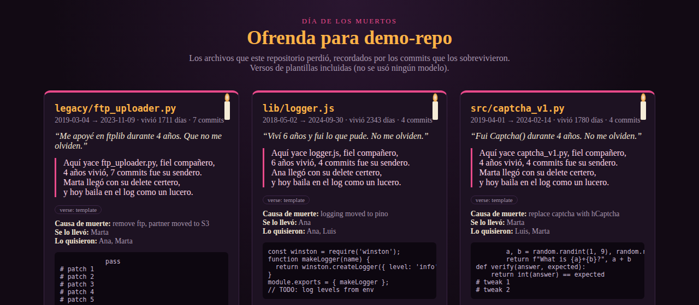
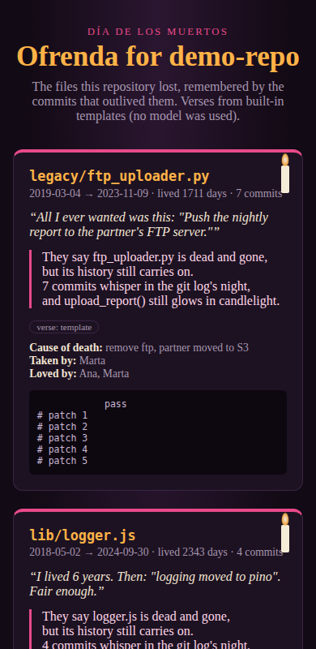
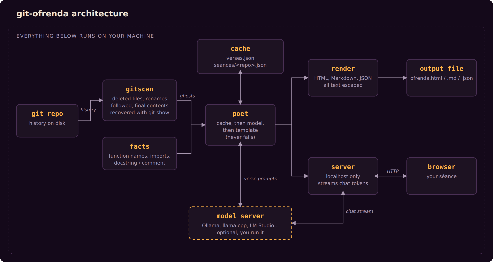

# git-ofrenda

Every long-lived repository has files that used to matter: an FTP uploader, a browser shim, a roadmap
nobody believed. git-ofrenda finds them in your history and builds an ofrenda for them, the Día de los
Muertos altar of remembrance. Each deleted file gets a card with its dates, who deleted it and why, its
last lines, and a *calavera literaria* (the short satirical epitaph that is part of the tradition).
The verses are written by a model running on your own machine. There is also a mode where you can chat
with each file.



The screenshots in this README come from the real tool, but they were taken on a machine without a
language model, so they show the built-in template mode. Each card is labelled `verse: template` and
the page header says no model was used. With a model running, the verses are written from the file's
actual contents and the header says which model wrote them.

## Install

Python 3.9 or newer and git. There are no other dependencies.

```
git clone <this repository>
cd git-ofrenda
pip install .
```

This installs a `git-ofrenda` command (git also runs it as `git ofrenda`).

## Usage

```
git-ofrenda doctor              # check git and your model server
git-ofrenda scan                # list dead files in the current repo, no model needed
git-ofrenda build               # write ofrenda.html with the 6 most-loved dead files
git-ofrenda seance              # serve a page where you can talk to them
git-ofrenda exhume . ./grave    # restore their final contents into ./grave
```

`git-ofrenda [repo]` is shorthand for `git-ofrenda build [repo]`. To try it without a repository of your
own, `python examples/make_demo_repo.py /tmp/demo-repo` builds one with a plausible history.



Options shared by `scan`, `build`, `seance` and `exhume`:

| Option | Meaning |
|---|---|
| `-n, --limit N` | how many files to include (0 for all) |
| `--include GLOB`, `--exclude GLOB` | filter by path; repeatable |
| `--since WHEN` | only files deleted since a date, e.g. `2023-01-01` or `"1 year ago"` |

Options for `build` and `seance`:

| Option | Meaning |
|---|---|
| `--backend ollama\|openai\|none` | kind of model server (default `ollama`) |
| `--model NAME` | model name (default `gemma3`) |
| `--host URL` | model server address |
| `--lang en\|es` | language of the page, verses and séance |
| `-o FILE` | output file; `.md` and `.json` select those formats, `-` writes to stdout |
| `--no-cache`, `--refresh` | skip the verse cache, or rewrite cached verses |

## What a card shows



The dates and lifespan come from `git log --follow`, so a file that was renamed during its life is
credited with its full age. The cause of death is the message of the commit that deleted it. Files that
were merely renamed are not counted as deleted. Binary files, empty files and files over 2 MB are skipped.
Files are ranked by how much they were worked on (commit count, weighted by lifespan).

## Model setup

git-ofrenda talks to a server you run yourself; nothing is sent anywhere else.

| Server | Start it with | Options |
|---|---|---|
| Ollama | `ollama pull gemma3` | `--backend ollama --model gemma3` (the defaults) |
| llama.cpp | `llama-server -m model.gguf --port 8080` | `--backend openai --host http://localhost:8080` |
| LM Studio | start its local server | `--backend openai --host http://localhost:1234` |
| vLLM, LocalAI, etc. | any OpenAI-compatible server | `--backend openai --host URL --model NAME` |

These can also be set through `OFRENDA_BACKEND`, `OFRENDA_MODEL`, `OFRENDA_HOST`, `OFRENDA_API_KEY` (for
servers that require one) and `OFRENDA_CACHE` (default `~/.cache/git-ofrenda`).

If the server is not running, or the model replies in the wrong format twice in a row, that ghost gets a
template verse instead and the page says so. Generated verses are cached by model, language and file,
so running the command again is instant.

## The séance

`git-ofrenda seance` serves the page on `127.0.0.1` and opens it in your browser. Each card has a button
that opens a chat with that file. The model is given the file's final contents and its history and
asked to stay within them. Replies stream in as they are generated, and conversations are saved per
repository.



Without a model the file answers from git facts instead (who wrote it, when, why it was deleted, what
functions it held), shown in italics.

`--lang es` switches the page, verses and séance to Spanish:



The page is a single HTML file with no external requests, and it works on a phone:



## How it works



1. `gitscan` lists files deleted from history (`git log --diff-filter=D -M`), follows renames to get each
   file's real birth date and authors, and recovers its last contents with `git show`. In repositories
   with many deletions it ranks candidates in one cheap pass before doing the detailed work.
2. `poet` writes the verses. It checks the cache, asks the model, parses the reply strictly, retries
   once, and falls back to templates built from facts `facts` extracted (function names, imports, a
   header comment). The templates only mention things they actually found.
3. `render` produces the HTML, Markdown or JSON. `server` serves the same page with a streaming chat
   endpoint for the séance.

See [docs/ARCHITECTURE.md](docs/ARCHITECTURE.md) for module-by-module notes.

## Privacy and safety

The only network traffic is between git-ofrenda and the model server you point it at, which defaults to
localhost. The séance server listens on `127.0.0.1` only, rejects requests with a foreign `Host` header,
requires a custom header on POST requests, and limits request sizes. File names, commit messages, author
names, verses and chat history are all HTML-escaped before they reach the page.

## Development

```
pip install -e .
python -m unittest discover -s tests -v
```

The 45 tests build real git repositories (with renames, binary files and deletions) and run the actual
HTTP and streaming code against small fake Ollama and OpenAI-compatible servers in `tests/fakes.py`. They
cover scanning, ranking, output parsing, caching, rendering, the server's security checks and every CLI
command, including the model-down and malformed-output paths. They do not test a real model, because
the model is not part of the repository; the fakes only prove that the client speaks the protocols
correctly. A `Dockerfile` (for `scan`, `build` and `exhume`) and a GitHub Actions workflow are included;
both were written but not run when this was prepared, and the test suite was only run on Python 3.12 on
Linux.

## Limitations

- A heavily rewritten rename can look like a deletion plus a new file.
- Only the first 2,500 characters of a file are sent to the model.
- Template verses are only as specific as the facts that can be extracted from the file.
- Small models write plainer verses and sometimes ignore the requested format.

## License

MIT.
